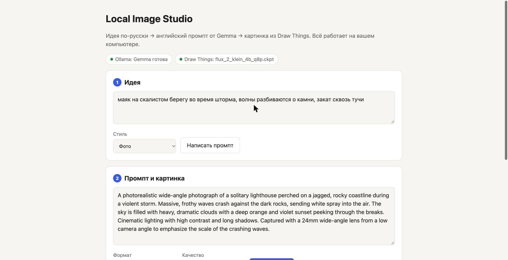
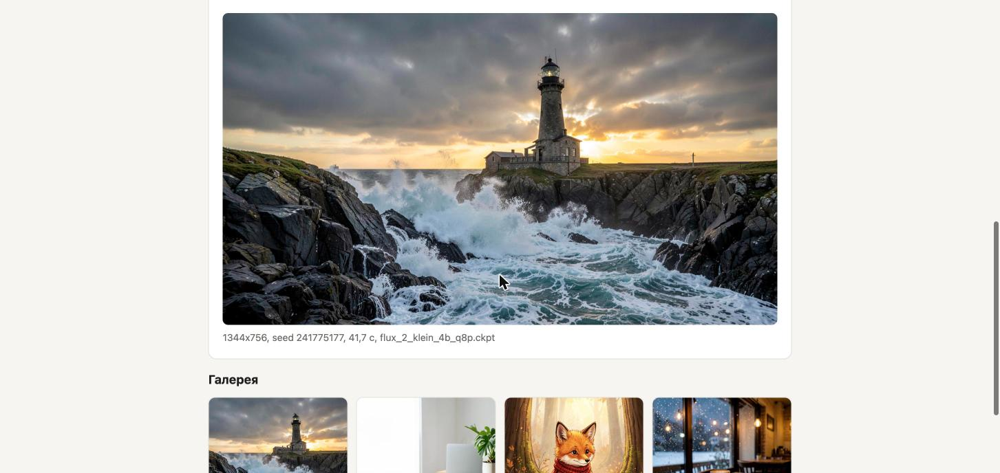
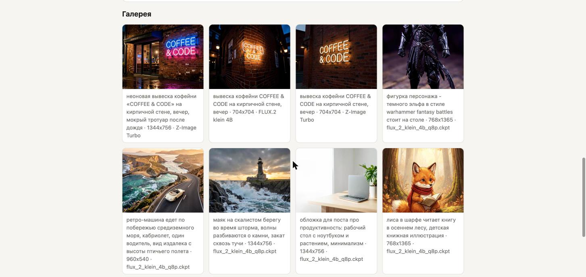
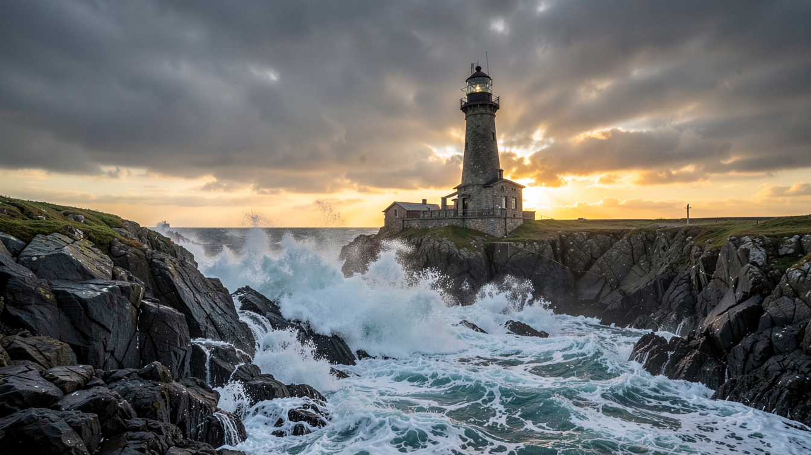

# Local Image Studio

Локальная студия картинок: пишете идею по-русски, локальная модель Gemma превращает её в подробный английский промпт, Draw Things рисует картинку нужного формата. Всё работает на вашем Mac — без подписок, облачных сервисов и знания промпт-инжиниринга.



## Проблема

Картинки для постов, презентаций и лендингов нужны постоянно. Облачные генераторы стоят денег, бывают недоступны и требуют отправлять материалы на чужие серверы. Локальные модели бесплатны, но с ними неудобно: промпт нужно писать по-английски и подробно, а размер подбирать вручную — модель принимает только стороны, кратные 64, поэтому «просто Full HD» не получается.

## Пользователь

- Блогеры и эксперты — обложки и иллюстрации к постам.
- Малый бизнес — картинки для сайта, соцсетей и карточек товаров.
- Команды, которым нельзя отправлять материалы в облако.
- Владельцы Mac на Apple Silicon, которые хотят пользоваться локальными моделями без настройки.

## Основная функция

1. **Вход:** идея на русском языке и стиль — фото, иллюстрация или обложка для поста.
2. **Промпт:** Gemma 4 12B в Ollama пишет английский промпт на 50–90 слов и сохраняет все детали идеи. Промпт можно поправить вручную.
3. **Генерация:** выбираете формат (1:1, 16:9, 9:16, 4:3, 3:4) и качество (черновик 0,5 Мп, обычное 1 Мп, Full HD). Студия сама подбирает размер, допустимый для модели, отправляет запрос в Draw Things и обрезает результат до точного размера.
4. **Выход:** PNG-файл в папке `outputs/` и запись в галерее: промпт, Seed, модель, размер, время генерации.

## Формат результата

Готовая картинка точного размера (например, 1920×1080 для Full HD 16:9) и галерея всех генераций с параметрами — любую удачную картинку можно повторить по тому же промпту и Seed.





Пример готовой картинки — идея «маяк на скалистом берегу во время шторма, волны разбиваются о камни, закат сквозь тучи», 16:9, 1344×756, 42 секунды на MacBook M3 Pro:



## Минимальный функционал (MVP)

Реализовано:

- веб-интерфейс на `localhost` в два шага: идея → промпт → картинка;
- три стиля промпта: фото, иллюстрация, обложка для поста;
- пять форматов и три уровня качества, точный размер на выходе;
- галерея с параметрами каждой генерации;
- строка состояния: при открытии страницы и каждые 10 секунд студия проверяет, отвечают ли Ollama и Draw Things, и подсказывает, что включить;
- защита от двух генераций одновременно и понятные сообщения об ошибках на русском.

Дальше в планах:

- пакетная генерация по списку тем из контент-плана;
- выбор модели Draw Things из интерфейса и сравнение моделей на одном Seed;
- апскейлер для 4K;
- фирменные стили с сохранёнными настройками.

## Технологии

- **Python 3.9+**, только стандартная библиотека: `http.server`, `urllib`, `json` — ничего не нужно устанавливать через pip.
- **Ollama** с моделью `gemma-4-12b-it` (GGUF Q4_K_M) — пишет промпты, API `POST /api/generate`.
- **Draw Things** с моделью FLUX.2 klein 4B — генерирует картинки, HTTP API в формате Automatic1111 (`POST /sdapi/v1/txt2img`).
- **sips** из macOS — обрезка до точного размера.
- **HTML, CSS и JavaScript** без фреймворков — интерфейс со светлой и тёмной темой.

Время на MacBook M3 Pro (36 ГБ): промпт — 6–11 с, картинка 1 Мп — около 40 с, Full HD — около 90 с.

## Установка и запуск

Нужен Mac на Apple Silicon.

1. Установите [Ollama](https://ollama.com) и скачайте модель:
   ```bash
   ollama pull hf.co/unsloth/gemma-4-12b-it-GGUF:Q4_K_M
   ```
2. Установите [Draw Things](https://drawthings.ai), скачайте в нём модель (например, FLUX.2 klein 4B) и включите API-сервер: настройки → API Server → HTTP, порт 7860.
3. Склонируйте репозиторий и запустите студию:
   ```bash
   git clone https://github.com/alexandrsaturn-eng/local-image-studio.git
   cd local-image-studio
   python3 app.py
   ```
4. Откройте http://127.0.0.1:8000. Под заголовком обе метки должны быть зелёными: «Ollama: Gemma готова» и «Draw Things: имя модели». Если метка красная, рядом будет подсказка, что включить.

Draw Things не всегда сам включает API-сервер после перезапуска. Если метка Draw Things красная, проверьте настройку API Server в приложении.

Другую модель Ollama или другие адреса можно указать в начале файлов `prompt_writer.py` и `drawthings.py`.

## Как пользоваться

1. Опишите идею по-русски, выберите стиль и нажмите **«Написать промпт»**.
2. Проверьте промпт, при желании поправьте его.
3. Выберите формат и качество, нажмите **«Нарисовать»**. Таймер покажет, сколько идёт генерация.
4. Картинка появится на странице и в галерее, файл — в папке `outputs/`.

## Структура проекта

```
app.py              веб-сервер и API: /api/prompt, /api/generate, /api/gallery, /api/status
prompt_writer.py    идея → английский промпт через Ollama
drawthings.py       размеры, генерация в Draw Things, обрезка
static/             интерфейс: index.html, style.css, app.js
images/             скриншоты для README
outputs/            сгенерированные картинки и gallery.json (не в git)
.claude/skills/     скилл для Claude Code
```

## Скилл для Claude Code

В папке `.claude/skills/local-image-studio/` лежит скилл: с ним Claude Code понимает структуру проекта, умеет запускать студию, проверять, что Ollama и Draw Things отвечают, вносить изменения и обновлять README. Откройте папку проекта в Claude Code — скилл подхватится автоматически.
